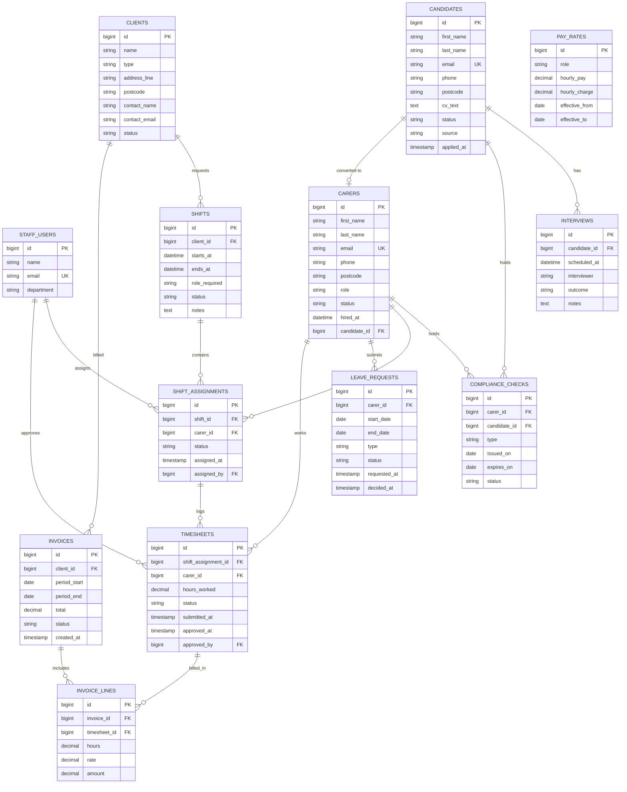

# CareOps Legacy Database Schema Documentation

This document describes the 13 relational tables modeling the existing UK care-staffing business (CareOps Ltd), their columns, and their relationships.

---

## 1. Entity-Relationship (ER) Diagram

---

## 2. Table Specifications

### 2.1 `staff_users`
Internal office employees (recruitment, HR, operations, and finance teams) who approve shifts, timesheets, and candidate hires.
- `id` (BIGINT UNSIGNED, PK, AUTO_INCREMENT)
- `name` (VARCHAR 255)
- `email` (VARCHAR 255, UNIQUE)
- `department` (VARCHAR 255: `recruitment`, `hr`, `operations`, `finance`)
- `created_at`, `updated_at` (TIMESTAMP)

### 2.2 `candidates`
Applicants applying for care positions before being hired.
- `id` (BIGINT UNSIGNED, PK, AUTO_INCREMENT)
- `first_name`, `last_name` (VARCHAR 255)
- `email` (VARCHAR 255, UNIQUE)
- `phone` (VARCHAR 255)
- `postcode` (VARCHAR 255)
- `cv_text` (TEXT, nullable): Unstructured text extracted from applicant CVs.
- `status` (VARCHAR 255: `applied`, `screening`, `interview`, `offered`, `hired`, `rejected`)
- `source` (VARCHAR 255: `website`, `agency`, `referral`, `job_board`)
- `applied_at` (TIMESTAMP)

### 2.3 `interviews`
Scheduled interviews between candidates and internal staff.
- `id` (BIGINT UNSIGNED, PK, AUTO_INCREMENT)
- `candidate_id` (BIGINT UNSIGNED, FK -> `candidates.id`)
- `scheduled_at` (DATETIME)
- `interviewer` (VARCHAR 255)
- `outcome` (VARCHAR 255: `pending`, `pass`, `fail`, `no_show`)
- `notes` (TEXT, nullable)

### 2.4 `carers`
Care workers employed or registered with the agency.
- `id` (BIGINT UNSIGNED, PK, AUTO_INCREMENT)
- `first_name`, `last_name` (VARCHAR 255)
- `email` (VARCHAR 255, UNIQUE)
- `phone` (VARCHAR 255)
- `postcode` (VARCHAR 255)
- `role` (VARCHAR 255: `carer`, `senior_carer`)
- `status` (VARCHAR 255: `active`, `suspended`, `left`)
- `hired_at` (TIMESTAMP)
- `candidate_id` (BIGINT UNSIGNED, nullable, FK -> `candidates.id`)

### 2.5 `compliance_checks`
Regulatory compliance checks for carers and candidates (DBS, Right to Work, Training).
- `id` (BIGINT UNSIGNED, PK, AUTO_INCREMENT)
- `carer_id` (BIGINT UNSIGNED, nullable, FK -> `carers.id`)
- `candidate_id` (BIGINT UNSIGNED, nullable, FK -> `candidates.id`)
- `type` (VARCHAR 255: `dbs`, `right_to_work`, `moving_handling`, `safeguarding`)
- `issued_on` (DATE)
- `expires_on` (DATE)
- `status` (VARCHAR 255: `valid`, `expiring_soon`, `expired`)

### 2.6 `clients`
Care homes and domiciliary care facilities requiring agency staffing.
- `id` (BIGINT UNSIGNED, PK, AUTO_INCREMENT)
- `name` (VARCHAR 255)
- `type` (VARCHAR 255: `care_home`, `domiciliary`)
- `address_line`, `postcode` (VARCHAR 255)
- `contact_name`, `contact_email` (VARCHAR 255)
- `status` (VARCHAR 255: `active`, `inactive`)

### 2.7 `shifts`
Individual shifts requested by clients.
- `id` (BIGINT UNSIGNED, PK, AUTO_INCREMENT)
- `client_id` (BIGINT UNSIGNED, FK -> `clients.id`)
- `starts_at` (DATETIME)
- `ends_at` (DATETIME)
- `role_required` (VARCHAR 255: `carer`, `senior_carer`)
- `status` (VARCHAR 255: `open`, `assigned`, `completed`, `cancelled`)
- `notes` (TEXT, nullable)

### 2.8 `shift_assignments`
The link between a carer and an assigned shift.
- `id` (BIGINT UNSIGNED, PK, AUTO_INCREMENT)
- `shift_id` (BIGINT UNSIGNED, FK -> `shifts.id`)
- `carer_id` (BIGINT UNSIGNED, FK -> `carers.id`)
- `status` (VARCHAR 255: `confirmed`, `cancelled`, `no_show`)
- `assigned_at` (TIMESTAMP)
- `assigned_by` (BIGINT UNSIGNED, nullable, FK -> `staff_users.id`)
- *Note:* Deliberately lacks a database-level unique overlap constraint to allow legacy data imperfections (P3).

### 2.9 `leave_requests`
Annual, sick, and unpaid leave records for carers.
- `id` (BIGINT UNSIGNED, PK, AUTO_INCREMENT)
- `carer_id` (BIGINT UNSIGNED, FK -> `carers.id`)
- `start_date`, `end_date` (DATE)
- `type` (VARCHAR 255: `annual`, `sick`, `unpaid`)
- `status` (VARCHAR 255: `pending`, `approved`, `rejected`)
- `requested_at` (TIMESTAMP)
- `decided_at` (TIMESTAMP, nullable)

### 2.10 `pay_rates`
Hourly pay and charge rates per role.
- `id` (BIGINT UNSIGNED, PK, AUTO_INCREMENT)
- `role` (VARCHAR 255: `carer`, `senior_carer`)
- `hourly_pay` (DECIMAL 8, 2)
- `hourly_charge` (DECIMAL 8, 2)
- `effective_from` (DATE)
- `effective_to` (DATE, nullable)

### 2.11 `timesheets`
Hours logged by carers for completed shifts.
- `id` (BIGINT UNSIGNED, PK, AUTO_INCREMENT)
- `shift_assignment_id` (BIGINT UNSIGNED, FK -> `shift_assignments.id`)
- `carer_id` (BIGINT UNSIGNED, FK -> `carers.id`)
- `hours_worked` (DECIMAL 5, 2)
- `status` (VARCHAR 255: `submitted`, `approved`, `rejected`)
- `submitted_at` (TIMESTAMP)
- `approved_at` (TIMESTAMP, nullable)
- `approved_by` (BIGINT UNSIGNED, nullable, FK -> `staff_users.id`)
- *Note:* Deliberately lacks a unique constraint on `shift_assignment_id` to allow legacy duplicate timesheet anomalies (P4).

### 2.12 `invoices`
Periodic invoices generated for client facilities.
- `id` (BIGINT UNSIGNED, PK, AUTO_INCREMENT)
- `client_id` (BIGINT UNSIGNED, FK -> `clients.id`)
- `period_start`, `period_end` (DATE)
- `total` (DECIMAL 10, 2)
- `status` (VARCHAR 255: `draft`, `sent`, `paid`)
- `created_at`, `updated_at` (TIMESTAMP)

### 2.13 `invoice_lines`
Individual line items tying timesheets and billable hours to an invoice.
- `id` (BIGINT UNSIGNED, PK, AUTO_INCREMENT)
- `invoice_id` (BIGINT UNSIGNED, FK -> `invoices.id`)
- `timesheet_id` (BIGINT UNSIGNED, nullable, FK -> `timesheets.id`)
- `hours` (DECIMAL 5, 2)
- `rate` (DECIMAL 8, 2)
- `amount` (DECIMAL 10, 2)

