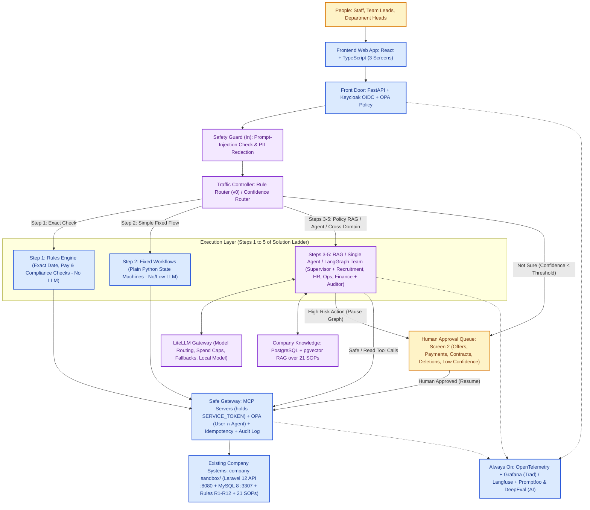
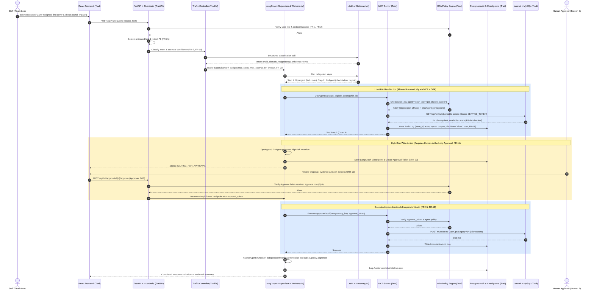
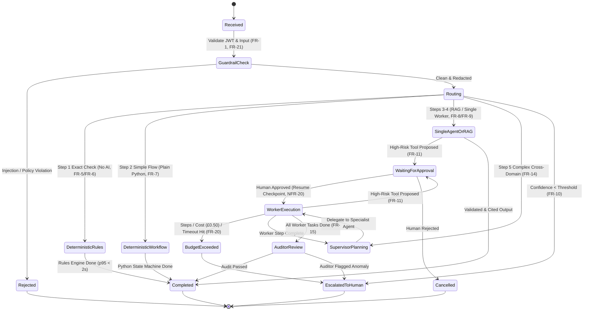

# CareOps Agent Platform: System Architecture

**Status:** Draft v0.2 (aligned with [`docs/project-brief.md`](project-brief.md) v0.2 & [`docs/roadmap.md`](roadmap.md) v0.2)  
**Related Documents:** [`docs/project-brief.md`](project-brief.md) | [`docs/roadmap.md`](roadmap.md) | [`ADR-001`](adr/ADR-001-router-first-multi-agent-where-justified.md) | [`ADR-002`](adr/ADR-002-orchestration-framework.md) | [`ADR-003`](adr/ADR-003-permissions-outside-the-model.md) | [`ADR-004`](adr/ADR-004-simulated-existing-company.md) | [`AGENTS.md`](../AGENTS.md)

---

## 1. Executive Summary & Core Design Philosophy

The **CareOps Agent Platform** automates routine recruitment, HR, operations, and finance administration for a fictional UK care-staffing business (**CareOps Ltd**). Because care staffing is a regulated, people-sensitive sector operating under UK GDPR, the architecture treats AI models as **untrusted reasoning components** wrapped inside deterministic **traditional software engineering controls**.

### 1.1 Architectural Pillars (Aligned with [`docs/project-brief.md`](project-brief.md) Sections 5 & 7)

1. **Simplest Solution First — The 6-Step Ladder ([ADR-001](adr/ADR-001-router-first-multi-agent-where-justified.md)):**
   - **Step 0 (Process Redesign):** Fix paper bottlenecks (Form HR-7B, `Q-5`), contradictory SOPs (duplicate annual-leave policies, `Q-4`), and duplicate client records before automating.
   - **Step 1 (Rules Engine, No AI):** Exact date, arithmetic, overlap, and lookup checks (`FR-5`, `FR-6`).
   - **Step 2 (Fixed Workflows, No AI):** Plain Python state machines for predictable multi-step flows (`FR-7`, `FR-16`, `FR-17`).
   - **Step 3 (Single AI Call + RAG):** One LiteLLM call grounded in the 21 SOPs via PostgreSQL + `pgvector` with citations and Pydantic structured output (`FR-8`).
   - **Step 4 (Single Specialist Agent):** One bounded LangGraph worker with its own identity, minimal MCP toolset, and budget (e.g., Recruitment CV screening, `FR-9`).
   - **Step 5 (Multi-Agent Team):** LangGraph **Supervisor (Coordinator)** + domain Worker Agents + independent **Auditor (Checker)**, used *only* for open-ended cross-domain tasks (`FR-13` to `FR-15`).
2. **Explicit Control Flow & State Persistence ([ADR-002](adr/ADR-002-orchestration-framework.md)):** Stateful flows use **LangGraph** with PostgreSQL checkpointing for durable human-in-the-loop pause/resume gates (`NFR-20`). Simple flows use plain Python and a rules engine. CrewAI and AutoGen are not used.
3. **Permissions Outside the Model ([ADR-003](adr/ADR-003-permissions-outside-the-model.md)):** System prompts are requests, not security controls. Identity is verified via **Keycloak (OIDC)** (`FR-1`), authorization is enforced by **OPA (Rego)** as `User Permissions ∩ Agent Permissions` (`FR-2`), and the handed-over legacy system ([ADR-004](adr/ADR-004-simulated-existing-company.md)) is reached exclusively through **MCP servers** (`NFR-1`, `NFR-2`).
4. **Humans Decide High-Risk & Low-Confidence Actions (`FR-10`, `FR-11`, `NFR-4`):** Job offers/hires, payments, payroll modifications, contract changes, personal data deletion, and low-confidence router/model outputs halt execution and route to the human approval queue (`Screen 2`).
5. **Separation of Duties, Full Auditability & Named Ownership (`FR-15`, `FR-18`, `NFR-11`):** Every action logs user identity, agent identity, inputs, outputs, OPA policy decision, token cost, and OpenTelemetry trace ID. A dedicated **Auditor Agent** reviews actions taken by worker agents and can never review its own work. Every live agent has a **named human owner** accountable for its outcomes, cost, and incidents.

### 1.2 Plain-English to Engineering Terminology Map

To keep [`docs/project-brief.md`](project-brief.md) accessible to non-technical stakeholders while giving engineers exact module names, terms map 1-to-1:

| Term in `project-brief.md` | Engineering Component in `architecture.md` & Code |
|---|---|
| **Front Door** | FastAPI OIDC Auth Middleware + Keycloak JWT Verification + Top-Level OPA Check (`services/agent-api`) |
| **Safety Guard (in / out)** | Input Prompt-Injection Screening, PII Redaction & Pydantic Output Validator (`services/agent-api`) |
| **Traffic Controller** | Rule-Based Router (v0) & Structured LLM Intent/Confidence Router (`services/agent-api`) |
| **Rules (Step 1)** | Deterministic Rules Engine (`RulesEngine` in `services/agent-api`, zero LLM calls) |
| **Fixed Workflows (Step 2)** | Plain Python State Machines (`PyStateMachine` in `services/agent-api`, zero/low LLM calls) |
| **Company Knowledge (RAG, Step 3)** | PostgreSQL + `pgvector` semantic search over the 21 SOPs in `company-sandbox/sops/` with citations |
| **Coordinator (Step 5)** | `Supervisor Agent` (`agents/supervisor`) in LangGraph |
| **Specialist Helpers (Steps 4–5)** | `Recruitment` (`agents/recruitment`), `HR` (`agents/hr`), `Operations` (`agents/ops`), `Finance` (`agents/finance`) |
| **Checker (Step 5)** | `Auditor Agent` (`agents/auditor`) — independent reviewer, barred by OPA from reviewing its own actions |
| **Safe Gateway** | MCP Tool Servers (`services/mcp-servers`) + OPA (`User ∩ Agent`) + Idempotency + Audit Writer + `SERVICE_TOKEN` |
| **Existing Company Systems** | Pre-existing CareOps Legacy Stack in `company-sandbox/` (Laravel 12.72 + MySQL 8.0 + 21 SOPs, rules `R1–R12`) |
| **Logbook** | Immutable PostgreSQL Audit Log + OpenTelemetry Traces + Langfuse Cost/Prompt Traces |

---

## 2. Diagram Color Legend

Throughout all architecture diagrams in this document, components are color-coded to distinguish **Traditional Software Engineering** from **AI Engineering**:

- 🟦 **Blue (`trad`) — Traditional Software Engineering Components:** Web UI, FastAPI REST API, Keycloak (OIDC), OPA (Rego Policy Engine), Rules Engine, Plain Python State Machines, MCP Servers, Redis, PostgreSQL (Relational Data), Laravel + MySQL Legacy Backend, OpenTelemetry, Grafana, Docker/Kubernetes.
- 🟪 **Purple (`ai`) — AI Engineering Components:** Intent Router / Classifier, Input/Output Guardrails & PII Redaction, LangGraph Orchestrator, Supervisor & Specialist Worker Agents (Recruitment, HR, Ops, Finance), Auditor Agent, LiteLLM Gateway, `pgvector` (RAG Embeddings), Langfuse, Promptfoo / DeepEval.
- 🟨 **Amber (`human`) — Human Actors & Approval Gates:** Staff, Team Leads, Department Heads, and Human-in-the-Loop (HITL) decision checkpoints.

---

## 3. High-Level Design (HLD)

The High-Level Design illustrates the end-to-end flow from a staff member's request down to the legacy company systems, matching the simple HLD in [`docs/project-brief.md`](project-brief.md) (Section 6) and showing how traditional software boundaries wrap and govern AI components.



### HLD Walkthrough
1. **People & Web App (Traditional, `FR-1`, `FR-3`, `FR-12`, `FR-23`):** Staff submit requests (`Screen 1`), Team Leads and Department Heads approve or reject risky/uncertain actions (`Screen 2`), and Department Heads monitor cost, latency, escalations, eval scores, and audit logs (`Screen 3`).
2. **Front Door (Traditional, `FR-1`, `FR-2`):** FastAPI validates the user's OIDC JWT from Keycloak and checks endpoint permissions via OPA.
3. **Safety Guard & Traffic Controller (Traditional + AI, `FR-7`, `FR-10`, `FR-21`):** Untrusted text is screened for prompt injection and PII is masked before any external model call. The Traffic Controller starts as a deterministic rule-based router (`Phase 2`) and adds a structured confidence classifier (`Phase 3`), routing low-confidence requests straight to a human in `Screen 2`.
4. **Execution Paths — Climbing the Ladder (`ADR-001`, `ADR-002`):**
   - **Step 1 — Rules Engine (Traditional, `FR-5`, `FR-6`):** Exact compliance and financial checks (DBS/RTW expiry on shifts, shift overlaps, leave clashes, duplicate/excessive timesheets, invoice-line totals) run in deterministic Python with zero LLM calls and p95 < 2s (`NFR-7`).
   - **Step 2 — Fixed Workflows (Traditional, `FR-16`, `FR-17`):** Predictable recipes (leave requests, 30-day expiry warnings, timesheet reminders) run as plain Python state machines.
   - **Steps 3–5 — RAG, Single Agent & Multi-Agent Team (AI, `FR-8`, `FR-9`, `FR-13`–`FR-15`):** Policy questions use single-call RAG with citations (`Step 3`); bounded single-domain tasks use one LangGraph specialist agent (`Step 4`, e.g. CV screening); open-ended cross-domain tasks (`Step 5`, e.g. *"Carer resigned: find cover, check payroll impact, notify client"*) run under the **Supervisor Agent** with specialist workers and post-execution review by the **Auditor Agent**.
5. **Safe Gateway & Existing Systems (Traditional, `ADR-003`, `ADR-004`, `NFR-1`, `NFR-2`):** Agents hold no database credentials (`:3307` is unreachable) and no legacy API tokens. Every tool call passes through an **MCP Server**, which checks `User Permissions ∩ Agent Permissions` in **OPA**, enforces idempotency (`FR-19`), writes an immutable audit row (`FR-18`), and calls `company-sandbox/` (`http://localhost:8080/api`) using the `SERVICE_TOKEN` held exclusively by MCP. The legacy Laravel API enforces write rules **R1–R12** on mutations.

---

## 4. Low-Level Design (LLD)

The Low-Level Design details the internal services, sub-modules, data stores, external gateways, and network connections across the platform.

```mermaid
flowchart TB
    classDef trad fill:#dbeafe,stroke:#1d4ed8,color:#1e3a8a,stroke-width:2px
    classDef ai fill:#f3e8ff,stroke:#7e22ce,color:#581c87,stroke-width:2px
    classDef human fill:#fef3c7,stroke:#d97706,color:#78350f,stroke-width:2px

    subgraph ClientLayer["Client & Identity Layer"]
        UI_Req["Screen 1: Request & Progress (FR-3)"]:::trad
        UI_App["Screen 2: Approval & Escalation Queue (FR-12)"]:::trad
        UI_Dash["Screen 3: Heads-Only Dashboard (FR-23)"]:::trad
        Keycloak["Keycloak (OIDC Identity Provider, FR-1)"]:::trad
    end

    subgraph APILayer["services/agent-api (FastAPI Service)"]
        AuthMW["OIDC Auth & Trace Middleware"]:::trad
        ApprovalAPI["Approval & Escalation REST API (FR-10, FR-11)"]:::trad
        BudgetMgr["Run Budget, Step & Timeout Controller (FR-20)"]:::trad
        PIIFilter["Guardrails: Injection Check & PII Redactor (FR-21)"]:::ai
        IntentRouter["Traffic Controller: Rule / Confidence Router (FR-7, FR-10)"]:::ai
        RulesEngine["Step 1: Deterministic Rules Engine (FR-5, FR-6)"]:::trad
        PyStateMachine["Step 2: Plain Python State Machines (FR-16, FR-17)"]:::trad
    end

    subgraph AgentLayer["agents/ (Steps 3-5: LangGraph Orchestration)"]
        Checkpointer["LangGraph Postgres Checkpointer (Pause / Resume, NFR-20)"]:::ai
        Supervisor["Supervisor / Coordinator Agent (FR-14)"]:::ai
        RecAgent["Recruitment Agent (CV Screen, Compliance, FR-9)"]:::ai
        HRAgent["HR Agent (Onboarding, Leave, Training, FR-16)"]:::ai
        OpsAgent["Operations Agent (Shift Match, Cover, FR-13)"]:::ai
        FinAgent["Finance Agent (Timesheets, Invoices, Payroll, FR-17)"]:::ai
        AuditorAgent["Auditor / Checker Agent (Independent Reviewer, FR-15)"]:::ai
    end

    subgraph ModelAndDataLayer["Data, Memory & Model Layer"]
        LiteLLM["LiteLLM Gateway (Routing, Fallbacks, Spend Caps, FR-22)"]:::ai
        ExtModels["External LLMs (Claude / OpenAI - Redacted PII)"]:::ai
        LocalModel["Local LLM (Sensitive / Unredacted Data Route, NFR-13)"]:::ai
        Redis["Redis (Short-Term Memory FR-26, Job Queues, Idempotency Cache)"]:::trad
        PG_App["PostgreSQL: App State, Checkpoints, Approvals & Audit Log (FR-18)"]:::trad
        PG_Vector["PostgreSQL + pgvector: 21 SOPs RAG Store (FR-8)"]:::ai
    end

    subgraph ToolAndPolicyLayer["services/mcp-servers & Policy Layer"]
        OPA["OPA Engine (Rego Policies: User ∩ Agent RBAC, FR-2)"]:::trad
        MCP_HR["MCP Server: HR & Recruitment Tools"]:::trad
        MCP_Ops["MCP Server: Operations & Rostering Tools"]:::trad
        MCP_Fin["MCP Server: Finance & Payroll Tools"]:::trad
    end

    subgraph LegacyLayer["company-sandbox/ (Pre-Existing Company Systems)"]
        LaravelAPI["Laravel 12.72 REST API (nginx :8080, SERVICE_TOKEN, Write Rules R1-R12)"]:::trad
        MySQL[("MySQL 8.0 (Isolated Network :3307 - No Agent Access, 13 Tables)")]:::trad
        SOPDocs[("company-sandbox/sops/ (21 Markdown SOPs)")]:::trad
    end

    subgraph ObsAndEvalLayer["Observability & CI Evaluation Layer"]
        OTel["OpenTelemetry Collector (NFR-12)"]:::trad
        Grafana["Grafana (Latency, Infra, Error & Cost Dashboards)"]:::trad
        Langfuse["Langfuse (LLM Traces, Prompt Versions, Token Cost)"]:::ai
        EvalSuite["evals/ (Promptfoo / DeepEval + Injection Suite, FR-24)"]:::ai
    end

    %% Connections - Client to API
    UI_Req & UI_App & UI_Dash <-->|"OIDC Login"| Keycloak
    UI_Req & UI_App & UI_Dash -->|"HTTPS + Bearer JWT"| AuthMW
    AuthMW -->|"Verify Token"| Keycloak
    AuthMW -->|"Check Endpoint Policy"| OPA

    %% Inside API
    AuthMW --> ApprovalAPI
    AuthMW --> BudgetMgr
    BudgetMgr --> PIIFilter
    PIIFilter --> IntentRouter

    %% Routing
    IntentRouter -->|"Step 1: Exact Check"| RulesEngine
    IntentRouter -->|"Step 2: Simple Workflow"| PyStateMachine
    IntentRouter -->|"Step 4: Single Domain Agent"| RecAgent
    IntentRouter -->|"Step 5: Complex Cross-Domain"| Supervisor
    IntentRouter -->|"Confidence < Threshold"| ApprovalAPI

    %% Agent Graph internal
    Supervisor & RecAgent <--> Checkpointer
    Supervisor --> RecAgent & HRAgent & OpsAgent & FinAgent
    RecAgent & HRAgent & OpsAgent & FinAgent --> AuditorAgent
    AuditorAgent -->|"Flag / Escalate"| ApprovalAPI
    Checkpointer <-->|"Persist State"| PG_App
    ApprovalAPI <-->|"Read/Write Queue & Resume Graph"| PG_App

    %% RAG & Memory & LLM
    RecAgent & HRAgent & OpsAgent & FinAgent & Supervisor & AuditorAgent & IntentRouter -->|"OpenAI SDK Format"| LiteLLM
    LiteLLM -->|"Redacted Prompts"| ExtModels
    LiteLLM -->|"Sensitive Local Route"| LocalModel
    SOPDocs -.->|"Chunk & Embed"| PG_Vector
    RecAgent & HRAgent & OpsAgent & FinAgent <-->|"Semantic Retrieval + Citations"| PG_Vector
    PyStateMachine & Supervisor <-->|"Session & Queue"| Redis

    %% Tool calls via MCP
    RulesEngine & PyStateMachine --> MCP_HR & MCP_Ops & MCP_Fin
    RecAgent --> MCP_HR
    HRAgent --> MCP_HR
    OpsAgent --> MCP_Ops
    FinAgent --> MCP_Fin

    MCP_HR & MCP_Ops & MCP_Fin -->|"1. Check Policy (User + Agent + Tool)"| OPA
    MCP_HR & MCP_Ops & MCP_Fin -->|"2. Write Immutable Audit Record"| PG_App
    MCP_HR & MCP_Ops & MCP_Fin -->|"3. Idempotent HTTP Call + SERVICE_TOKEN"| LaravelAPI
    LaravelAPI <--> MySQL

    %% Observability
    AuthMW & MCP_HR & MCP_Ops & MCP_Fin -.->|"Spans & Metrics"| OTel
    OTel -.-> Grafana
    LiteLLM & Supervisor -.->|"Traces & Token Costs"| Langfuse
    EvalSuite -.->|"CI Regression & Red-Teaming"| AuthMW
```



---

## 5. Detailed Execution & Interaction Flows

### 5.1 Request Lifecycle & Security Boundary (Sequence Diagram)

This sequence shows how a complex cross-domain request is authenticated, routed, executed across MCP tools with OPA checks, paused for human approval on high-risk actions, audited by the independent Auditor Agent, and completed.



### 5.2 Agent Run State Machine (LangGraph Lifecycle)

Every stateful run in `agents/` follows a strict, bounded lifecycle enforced by traditional budget controllers and LangGraph checkpointers.



---

## 6. Technology Stack: Traditional Engineering vs. AI Engineering

This table matches [`AGENTS.md`](../AGENTS.md) and [`docs/project-brief.md`](project-brief.md) (Appendix C).

### 6.1 Traditional Software Engineering Stack 🟦

| Layer | Technology | Role in CareOps Platform | How It Connects |
|---|---|---|---|
| **Frontend** | **React, TypeScript, Tailwind CSS** | Renders exactly three screens: (1) Request & Progress (`FR-3`), (2) Approval & Escalation Queue (`FR-12`), (3) Heads-Only Dashboard (`FR-23`). | Authenticates via Keycloak OIDC; calls `services/agent-api` over HTTPS REST/SSE. |
| **API & Backend Core** | **Python 3.12, FastAPI, Pydantic v2** | Entry point for all client requests, schema validation at every boundary, approval state management, and budget enforcement (`FR-20`, `NFR-15`). | Validates Keycloak JWTs, queries OPA, invokes deterministic workflows or LangGraph, and writes to PostgreSQL/Redis. |
| **Deterministic Logic (Steps 1–2)** | **Rules Engine & Plain Python State Machines** | Handles exact date/arithmetic/overlap checks (`FR-5`, `FR-6`) and predictable workflows (`FR-16`, `FR-17`) with **zero AI guesswork**. | Invoked directly by the router inside `services/agent-api` and calls MCP tools for data access. |
| **Identity & Access (IAM)** | **Keycloak (OIDC)** | Issues signed JWTs for human users (`staff`, `team_lead`, `department_head`) and distinct service identities for each AI agent (`FR-1`). | Integrated with React frontend, FastAPI middleware, and MCP servers. |
| **Policy Engine** | **OPA (Open Policy Agent / Rego)** | Externalized policy-as-code engine. Enforces `User Permissions ∩ Agent Permissions` on every API request and MCP tool call (`FR-2`, `NFR-2`). | Queried over local HTTP by `agent-api` and `mcp-servers` before any state read/write. |
| **Tool Boundary (Safe Gateway)** | **MCP Servers (Model Context Protocol)** | The **only** doorway to company systems. Validates tool input schemas, checks OPA, writes audit logs (`FR-18`), holds `SERVICE_TOKEN`, and guarantees idempotency (`FR-19`). | Exposed to workflows and agents; translates tool calls into HTTP requests to `company-sandbox/` (`:8080` / `careops_sandbox_network`) without re-implementing legacy write rules R1–R12. |
| **App Database** | **PostgreSQL (Relational)** | Stores LangGraph checkpoints (`NFR-20`), human approval queues, immutable audit logs (`NFR-11`), and application state. | Accessed by `agent-api` and `mcp-servers` via async SQLAlchemy/asyncpg. |
| **Cache & Queues** | **Redis** | Short-term session memory (`FR-26`), rate-limiting counters, idempotency keys (`FR-19`), and background job queues (`NFR-9`). | Connected to `agent-api` and worker processes. |
| **Pre-Existing Company Backend** | **Laravel 12.72 (PHP 8.4) + MySQL 8.0** | Handed-over CareOps system (`company-sandbox/`) with 13 tables, ~30 REST endpoints (`openapi.yaml`), write rules R1–R12, and 21 SOPs (`sops/`). | Runs in its own Compose network; reachable **only** via HTTP by `services/mcp-servers` (never direct DB access on `:3307`, `NFR-1`). |
| **Infra & Telemetry** | **Docker Compose, K8s, Terraform, OpenTelemetry, Grafana, k6** | Local container orchestration (`NFR-17`), production manifests, distributed tracing spans (`NFR-12`), infrastructure dashboards, and load testing (`NFR-7`, `NFR-9`). | OTel collector receives spans from FastAPI, MCP servers, and Laravel; visualised in Grafana. |

---

### 6.2 AI Engineering Stack 🟪

| Layer | Technology | Role in CareOps Platform | How It Connects |
|---|---|---|---|
| **Traffic Controller (Router)** | **Rule Router (v0) + Structured LLM Classifier** | Maps explicit intents by rule first (`FR-7`), and uses a structured LLM classifier with confidence thresholds (`FR-10`) for ambiguous requests. | Calls LiteLLM with strict Pydantic structured output; routes low confidence to `Screen 2`. |
| **Agent Orchestration (Steps 4–5)** | **LangGraph** | Stateful graph execution for single-agent and cross-domain multi-agent tasks. Supports cyclical planning, persistent checkpoints, and `interrupt` gates (`ADR-002`). | Lives in `agents/`; persists state to PostgreSQL; invokes tools via MCP client adapters. |
| **Specialist Agents** | **Supervisor, Recruitment, HR, Ops, Finance, Auditor** | Narrow-purpose agents with isolated system prompts (versioned files), distinct Keycloak service identities, minimal toolsets, per-run budgets, and a named human owner. | Coordinated by the Supervisor graph; the **Auditor Agent** (`FR-15`) runs post-execution to verify compliance. |
| **Model Gateway** | **LiteLLM Gateway** | Unified proxy for all LLM calls (`FR-22`, `NFR-19`). Provides model routing (small/mid external models + local model), automatic fallbacks, cost tracking, and spend caps. | Agent code **never** imports provider SDKs directly; all calls go through LiteLLM's OpenAI-compatible endpoint. |
| **Knowledge Retrieval (RAG, Step 3)** | **PostgreSQL + pgvector** | Stores chunked embeddings of the 21 CareOps SOP markdowns from `company-sandbox/sops/` to ground answers with file and section citations (`FR-8`). | Queried via retrieval nodes during execution using cosine similarity + metadata filters. |
| **Safety & Guardrails** | **Input Screening, PII Redaction, Pydantic Output Validation** | Treats all external text (CVs, emails, documents, tool outputs) as untrusted (`FR-21`). Masks PII before external model calls and routes sensitive data to the local model (`NFR-13`). | Wraps the ingress/egress of `agent-api` and the LiteLLM call pipeline. |
| **LLM Observability** | **Langfuse** | Tracks prompt versions, step-by-step agent reasoning traces, latency per node, and exact token cost per agent and per task (`NFR-10`, `NFR-12`). | Integrated via OpenTelemetry / LiteLLM callbacks; feeds metrics into `Screen 3` (Heads-Only Dashboard). |
| **Automated Evals & Red-Teaming** | **Promptfoo / DeepEval** | Golden dataset regression testing (`NFR-5`, `NFR-6`), hallucination/citation grading, ADR-001 benchmark, and adversarial prompt-injection suites (`FR-24`, `NFR-3`). | Lives in `evals/`; runs in CI (`make eval`) to block regressions or unauthorized tool calls before merge. |

---

## 7. Repository & Component Ownership Mapping

This layout matches [`README.md`](../README.md), [`AGENTS.md`](../AGENTS.md), and [`docs/project-brief.md`](project-brief.md) (Appendix D):

```
care-ops-multi-agent-project/
├── services/
│   ├── agent-api/          # [Trad + AI] FastAPI app, OIDC/OPA middleware, router, rules engine, approval API
│   └── mcp-servers/        # [Trad]      MCP tool servers (HR, Ops, Finance) + OPA client + audit logger + SERVICE_TOKEN
├── company-sandbox/        # [Trad]      Pre-existing CareOps system (Laravel 12 + MySQL 8 + 21 SOPs, handed over running)
├── agents/
│   ├── supervisor/         # [AI]        Coordinator (LangGraph) for open-ended cross-domain requests
│   ├── recruitment/        # [AI]        CV screening, compliance status checks, interview proposals
│   ├── hr/                 # [AI]        Onboarding workflows, leave checks, training reminders
│   ├── ops/                # [AI]        Shift matching, urgent cover discovery
│   ├── finance/            # [AI]        Timesheet validation, invoice & payroll anomaly explanations
│   └── auditor/            # [AI]        Checker (independent post-action reviewer; cannot review own actions)
├── evals/                  # [AI]        Golden sets, regression checks, ADR-001 benchmark, prompt-injection suite
├── infra/                  # [Trad]      Docker Compose, OPA policies, Keycloak realms, Kubernetes, Terraform, k6
├── frontend/               # [Trad]      React + TypeScript + Tailwind (three screens only: Requests, Approvals, Dashboard)
├── docs/                   #             Project brief, architecture, roadmap, ADRs, compliance (DPIA, model card)
├── templates/
│   └── agent-starter/      # [Trad + AI] Reusable starter pattern for building new bounded helpers safely (FR-25)
└── local/                  #             Personal notes, learning log & sandbox evaluation guides (gitignored)
```

---

## 8. Defence-in-Depth & Safety Controls Summary

Because AI agents read untrusted text (such as candidate CVs or client emails) and interact with regulated care and payroll records, no single control is trusted on its own ([ADR-003](adr/ADR-003-permissions-outside-the-model.md)):

```mermaid
flowchart LR
    classDef trad fill:#dbeafe,stroke:#1d4ed8,color:#1e3a8a,stroke-width:2px
    classDef ai fill:#f3e8ff,stroke:#7e22ce,color:#581c87,stroke-width:2px
    classDef human fill:#fef3c7,stroke:#d97706,color:#78350f,stroke-width:2px

    L1["Layer 1: Keycloak OIDC (User & Agent Identity, FR-1)"]:::trad
    L2["Layer 2: Input Guardrails & PII Redaction (FR-21, NFR-13)"]:::ai
    L3["Layer 3: Budget & Timeout Caps (Steps, £0.50 Cap, Time, FR-20)"]:::trad
    L4["Layer 4: Least-Privilege Tool Scoping per Agent"]:::ai
    L5["Layer 5: MCP + OPA Policy Check (User ∩ Agent, FR-2, NFR-2)"]:::trad
    L6["Layer 6: Human Approval Gate (High-Risk & Low-Confidence, FR-10/11)"]:::human
    L7["Layer 7: Auditor Agent + Immutable Audit Log (FR-15, FR-18)"]:::ai

    L1 --> L2 --> L3 --> L4 --> L5 --> L6 --> L7
```



1. **Identity Intersection (`User ∩ Agent`):** Even if an HR staff member asks the Recruitment Agent to modify payroll, both the user's role **and** the Recruitment Agent's service identity lack payroll permissions in OPA.
2. **Untrusted Content Isolation:** External text from CVs or documents is delimited and never interpolated as system instructions. Even if a prompt injection succeeds inside an LLM, Layer 4 (scoped toolset) and Layer 5 (OPA enforcement in the MCP server) block unauthorized calls deterministically (`NFR-3`).
3. **Hard Approval Gates:** Any tool classified as high-risk (`send_job_offer` / `hire_candidate`, `approve_payment`, `update_payroll`, `modify_contract`, `delete_personal_data`) cannot execute in the MCP layer without a verifiable approval record created by a human with the required role (`NFR-4`).
4. **Idempotency & Audit Trail:** Every state-changing MCP tool requires an `idempotency_key` tied to the run checkpoint (`FR-19`), preventing duplicate payments or duplicate shift bookings on retry (`NFR-20`).

---

## 9. Non-Functional Targets, Capacity & Cost Mapping

This section connects the system architecture directly to the Non-Functional Requirements (`NFR-1` to `NFR-20`) and Back-of-the-Envelope Estimates in [`docs/project-brief.md`](project-brief.md) (Sections 10 & 14).

### 9.1 Latency, Reliability & Cost Budgets

| Path / Metric | Target (`project-brief.md`) | Architectural Mechanism |
|---|---|---|
| **Step 1 Rules & MCP Lookups (`NFR-7`)** | **p95 < 2 seconds** | Direct FastAPI → `RulesEngine` → MCP → `company-sandbox` HTTP call; zero LLM calls |
| **Step 3 Single LLM Call / RAG (`NFR-7`)** | **p95 < 15 seconds** | Single `pgvector` similarity lookup + single LiteLLM call with structured output |
| **Step 5 Multi-Agent Run (`NFR-7`)** | **p95 < 120 seconds** (excluding human approval wait) | Bounded LangGraph step count (`BudgetMgr`), scoped worker context, parallelizable read tools |
| **Task Cost & Run Caps (`NFR-10`, `FR-20`)** | **< £0.05 avg/task** (estimated ~£0.011); **£0.50 per-run hard cap**; 80% monthly alarm | Model tiering in LiteLLM (small model for simple tasks, mid-tier for reasoning), step/token caps in `BudgetMgr` |
| **Accuracy & Reliability (`NFR-5`, `NFR-6`)** | **≥ 85%** CV screening agreement; **≥ 95%** citation accuracy; **≥ 90%** golden-set task success | Versioned prompts, `pgvector` chunk citations, Pydantic validation, CI regression suite (`make eval`) |

### 9.2 Scalability Path: From 10 Users to Thousands (`NFR-9`, Section 14.1)

| Stage | Users | Daily Requests | Busiest Hour / Design Headroom (10x) | Architectural Scaling Strategy |
|---|---|---|---|---|
| **Stage 1: Pilot (Today)** | 10 office staff (4 teams) | ~300/day (~30 AI runs/day) | 60/hr → **0.2 RPS** | Single Docker Compose host; Postgres checkpointer & audit log (~1.8 MB/day, ~0.7 GB/yr) |
| **Stage 2: 12-Month Growth** | 100 office staff | ~3,000/day (~300 AI runs/day) | 600/hr → **1.7 RPS** | Stateless `agent-api` & `mcp-servers` replicas behind ingress; Redis queues for async runs (~6.6 GB/yr audit storage) |
| **Stage 3: National Scale (Future)** | 100 office staff + 2,000 carers | ~9,000/day (~900 AI runs/day) | 1,800/hr → **5.0 RPS** (k6 test: **10 RPS sustained, 25 RPS spike**, **10 parallel AI runs**) | Horizontal K8s pod autoscaling (`infra/`), Redis caching on read-heavy SOP/compliance lookups, partitioned Postgres audit tables (~20 GB/yr) |
