# CareOps Agent Platform: Delivery Roadmap

**Status:** Draft v0.2 (aligned with [`docs/project-brief.md`](project-brief.md) v0.2 & [`docs/architecture.md`](architecture.md) v0.2; needs owner approval)  
**Based on:** [`project-brief.md`](project-brief.md), [`architecture.md`](architecture.md), [ADR-001](adr/ADR-001-router-first-multi-agent-where-justified.md), [ADR-002](adr/ADR-002-orchestration-framework.md), [ADR-003](adr/ADR-003-permissions-outside-the-model.md), [ADR-004](adr/ADR-004-simulated-existing-company.md), [`AGENTS.md`](../AGENTS.md)

> **Starting Baseline:** The existing CareOps company backend (`company-sandbox/`: Laravel 12.72, PHP 8.4, MySQL 8.0 on `:3307`, nginx API on `http://localhost:8080/api`, ~30 endpoints in `openapi.yaml`, write rules R1–R12, and 21 SOPs in `sops/`) is **already running and handed over to us**. This roadmap covers building the AI Agent Platform on top of it.

---

## 0. How to read this roadmap

### 0.1 Approach: vertical slices climbing the 6-step ladder
This roadmap builds a **thin end-to-end slice first** (walking skeleton), then climbs the 6-step solution ladder defined in [`docs/project-brief.md`](project-brief.md) (Section 5) and [ADR-001](adr/ADR-001-router-first-multi-agent-where-justified.md) (`Step 0` Process Redesign → `Step 1` Rules → `Step 2` Fixed Workflows → `Step 3` Single AI Call + RAG → `Step 4` Single Agent → `Step 5` Multi-Agent + Checker). Every phase from Phase 1 onward ends with something that **runs end to end** through the real layers (UI → API → OPA → MCP → existing CareOps API → audit).

```mermaid
flowchart LR
    P0["P0 Platform Setup, Decisions & Baseline"] --> P1["P1 Walking Skeleton (UI -> API -> OPA -> MCP -> CareOps API)"]
    P1 --> P2["P2 Slice A: Steps 1-2 Rules & Python Flows (No LLM)"]
    P2 --> P3["P3 Slice B: Steps 3-4 RAG over SOPs + First Agent (CV Screening)"]
    P3 --> P4["P4 Slice C: Step 0 Redesign + High-Risk Approval (Job Offer)"]
    P4 --> P5["P5 Slice D: Step 5 Multi-Agent Cross-Domain + Auditor"]
    P5 --> P6["P6 Slice E: HR + Finance Flows + Agent Starter Template"]
    P6 --> P7["P7 Hardening: Evals, Injection Suite, Screen 3 Dashboard"]
    P7 --> P8["P8 Release: Deployment, k6 Load Tests, UK GDPR Docs, Demo"]
```

### 0.2 Markers used
| Marker | Meaning |
|---|---|
| 🧑 **HUMAN** | Needs the project owner (decision, sign-up, key, content, review). The agent must not invent or substitute it. |
| ⛔ **BLOCKER** | Work cannot continue until the human provides the item. Do not mock around it silently. If a placeholder is used for local development, it must be labelled as such and listed in `local/learning-log.md`. |
| 🤖 | Can be done by a coding agent after plan approval. |
| ✅ **DoD** | Definition of done for the phase (aligned with [`AGENTS.md`](../AGENTS.md) and [`docs/project-brief.md`](project-brief.md) Section 18). |

### 0.3 Rules that apply to every task (from `AGENTS.md`)
- Plan first, wait for approval, one component at a time within the current slice.
- No new dependency without stating why and recording it (ADR if significant).
- No secrets or `.env` committed. Only `.env.example` with placeholders.
- Synthetic data only. Never real personal data.
- Never weaken a test, eval, lint rule or policy to make something pass.
- Anything uncertain about UK law or GDPR is marked `TODO: verify`. Nothing is invented.
- After each component: update `local/learning-log.md`. Significant decisions get an ADR in `docs/adr/`.

### 0.4 Open items & cross-reference with `project-brief.md` Section 19 (`Q-1`–`Q-8`)
| # | Item | `project-brief.md` link | Why it matters |
|---|---|---|---|
| O1 | `AGENTS.md` says **Python 3.12**; this machine has **Python 3.13.5**. | Section 13 | Task 0.2 must resolve this (install 3.12 via `uv`, or amend AGENTS.md by ADR). Not assumed. |
| O2 | `uv` is not in the approved stack list. | Section 13 | It is a tooling choice. Needs your approval and a short ADR (rule 7). |
| O3 | The project is **not a git repository** (you asked not to init it yet). | Section 18.1 | Task 0.1 (git, `.gitignore` including `local/`, commits, CI) is **deferred until you say so**. |
| O4 | Platform Docker Compose location (`infra/` vs root) and network attachment to `careops_sandbox_network`. | Section 6 | Decide in Task 0.4. |
| O5 | Which external LLM providers you will use (Claude, OpenAI) and monthly/per-run budget caps. | `Q-2`, Section 5.7, 14.4 | Drives Phase 3 and is a blocker (`B6`) for it. |
| O6 | "Local model" runtime is unspecified in the docs. | `Q-1`, Section 5.7 | 🧑 choose one, record in ADR-008 (`B7`). Not invented here. |
| O7 | Embedding model for RAG is unspecified. | `Q-1`, Section 5.3 | 🧑 choose, record in ADR-008 (`B7`). |
| O8 | Frontend auth flow details (OIDC code flow with PKCE is common) are not in the docs. | `FR-1` | Confirm in ADR-007 before Phase 1 UI work. |

---

## Phase 0: Platform setup, decisions and ground rules
**Goal:** a verified Python/Node dev environment, open platform decisions closed, and "before" baseline numbers recorded (`project-brief.md` Section 15).  
**Vertical slice:** none (enabling work).

| Status | # | Task | Owner | Output / acceptance |
|---|---|---|---|---|
| [x] | 0.1 | Version control: `git init`, `.gitignore` (explicitly ignoring `local/` and `.env`), first commit, branch convention. | 🧑 approve, 🤖 do | Completed: repository initialized on `main`, strict branch/PR rules added to `AGENTS.md`, initial baseline commit created (`4bdf8ee`). |
| [x] | 0.2 | Check platform toolchain versions: Python, `uv`, Docker, Compose, Node. Record results. | 🤖 | `docs/dev-environment.md` listing versions found vs required. Python 3.12 gap resolved per `O1`. |
| [x] | 0.3 | Install any missing platform tools (e.g. `uv`, Python 3.12, Node). | 🧑 | Toolchain verified in `docs/dev-environment.md`. Python 3.12, `uv`, Docker, Node/npm present. Native `uv run` commands used on Windows. |
| [x] | 0.4 | Decide: platform Compose location, `company-sandbox` network attachment (`careops_sandbox_network` vs host `:8080`), `uv` adoption, local-model runtime (`Q-1`), embedding model (`Q-1`), OIDC flow (`O8`). | 🧑 | Closed via ADR-005 (`uv`), ADR-006 (Compose & network topology), ADR-007 (OIDC with PKCE), and ADR-008 (LiteLLM, Ollama, embeddings). |
| [x] | 0.5 | Create approved platform skeleton folders (matching `AGENTS.md`, `README.md`, `architecture.md` Section 7, and `project-brief.md` Appendix D). | 🤖 | `services/agent-api/`, `services/mcp-servers/`, `agents/`, `evals/`, `infra/`, `frontend/`, `templates/agent-starter/`. |
| [x] | 0.6 | Python workspace setup with `uv`: `pyproject.toml`, `uv sync`, dev tools (`ruff`, `black`, `mypy --strict`, `pytest`). | 🤖 | `uv sync` succeeds; `ruff`, `black --check`, `mypy --strict` run on an empty package (`NFR-15`). Each dependency listed with a reason. |
| [x] | 0.7 | Root `Makefile` with `test`, `lint`, `eval`, `up`, `down` targets (stubs allowed, clearly labelled). | 🤖 | `make lint` and `make test` run green on empty code (verified via `uv run` equivalents; GNU `make` pending `0.3`). |
| [x] | 0.8 | Root `.env.example` with placeholders (`CAREOPS_LEGACY_URL`, `CAREOPS_SERVICE_TOKEN` for MCP only, etc.) and Pydantic settings base class. | 🤖 | No real values. Config only via environment (no hard-coded URLs/models/thresholds). |
| [x] | 0.9 | Structured logging with trace-ID helper (no `print`). | 🤖 | Unit test proves trace ID appears in log records (`NFR-11`, `NFR-12`). |
| [x] | 0.10 | Baseline the "before" numbers (`Q-7`, Section 14.3 & 15 of `project-brief.md`): how long do manual tasks take today? | 🧑 | Baseline metrics established in `docs/baseline-metrics.md` covering all 7 operational tasks and Phase 8 empirical protocol (`Q-7`). |
| [x] | 0.11 | Review and update `local/learning-log.md` for Phase 0 platform setup. | 🧑 review, 🤖 draft | Entries 6 and 7 recorded; `local/tasks-with-learning.md` expanded with comprehensive technical interview prep. |

✅ **DoD:** `make lint` and `make test` green on the empty platform workspace; open items `O1` to `O8` closed or tracked; CareOps legacy system reachable on `http://localhost:8080/api/health`.

---

## Phase 1: Walking skeleton (thinnest end-to-end path)
**Goal:** prove the full platform wiring against the already-running CareOps legacy API with the *simplest possible* real request, before any AI (`FR-1` to `FR-4`, `FR-18`, `NFR-1`, `NFR-2`, `NFR-11`, `NFR-12`).  
**Slice:** *"Staff asks: what is the status of carer X's DBS check?"* flows UI (`Screen 1`) → FastAPI → Keycloak/OPA → MCP (`SERVICE_TOKEN`) → CareOps REST API (`company-sandbox/`) → audit log → UI. No LLM yet.

| Status | # | Task | Owner | Acceptance |
|---|---|---|---|---|
| [x] | 1.1 | Platform `docker-compose.yml` with **PostgreSQL (+ pgvector), Redis, Keycloak, OPA** (no MySQL — MySQL lives inside the handed-over `company-sandbox/`). Healthchecks + network link to `careops_sandbox_network`. | 🤖 | `docker compose up -d` brings all platform containers healthy (`NFR-17`); MCP container can curl `company-sandbox` `/api/health`. Port `3307` stays unexposed to agents (`NFR-1`). Completed on branch `phase/1-walking-skeleton`. |
| [ ] | 1.2 | Verify handed-over CareOps endpoints needed for the slice (`GET /api/health`, `GET /api/carers/{id}/compliance`) via integration check script. | 🤖 | Contract matches `company-sandbox/laravel-app/openapi.yaml` (`FR-4`). |
| [ ] | 1.3 | Keycloak realm export: 3 roles (`staff`, `team_lead`, `department_head`), 1 agent service identity, test users with `@example.test` emails (`FR-1`, `Q-6`). | 🧑 approve role model (`B4`), 🤖 build | Realm imports on startup. Test passwords from `.env.example` placeholders only. |
| [ ] | 1.4 | One OPA policy: staff may call `get_carer_dbs_status`. Policy unit tests (`opa test`). | 🤖 | Allow and deny cases tested (`FR-2`, `NFR-2`). |
| [ ] | 1.5 | First MCP server with **one tool** `get_carer_dbs_status`: input schema, OPA call, audit log write, wraps `GET /api/carers/{id}/compliance` using `SERVICE_TOKEN` (held only by MCP), test. | 🤖 | Meets Tool DoD (`project-brief.md` Section 18.2): schema, policy, audit call, and test present. Never duplicates legacy write rules R1–R12. |
| [ ] | 1.6 | Audit log table and writer in Postgres (who, agent, what, inputs, outputs, policy decision, cost, trace ID). | 🤖 | Written on every tool call, including denials (`FR-18`, `NFR-11`). Unit test. |
| [ ] | 1.7 | FastAPI `agent-api` skeleton: OIDC JWT validation, trace middleware, `/health`, `POST /requests` (wired to the one MCP tool). | 🤖 | Typed, Pydantic models at boundaries, `mypy --strict` clean (`NFR-15`). |
| [ ] | 1.8 | OpenTelemetry wiring to a collector; spans across `agent-api` and MCP server. | 🤖 | One request shows one distributed trace across services (`NFR-12`). |
| [ ] | 1.9 | React + TS + Tailwind skeleton with OIDC login and **Screen 1 (Request and progress)** minimal (`FR-3`, `NFR-18`). | 🤖 | Logs in via Keycloak, submits request, displays carer DBS status from CareOps. |
| [ ] | 1.10 | End-to-end test (API level) and one denial test (user without role). | 🤖 | Passes in `make test`. |
| [ ] | 1.11 | CI pipeline running lint, type check, tests. | 🧑 choose CI host (`B3`), 🤖 write | ⛔ BLOCKER until `O3` (git) is done and a CI host is chosen. Tests still run locally via `make`. |
| [ ] | 1.12 | Update `local/learning-log.md` and reconcile `architecture.md` if the skeleton revealed changes. | 🤖 draft, 🧑 review | Diagram vs reality checked. |

✅ **DoD:** from `docker compose up -d` alongside the running `company-sandbox`, a test user sees a carer's DBS status through `Screen 1` in under 2 seconds (`NFR-7`), backed by an audit row and one OTel trace.

---

## Phase 2: Slice A, Steps 1–2 exact checks & fixed workflows with no LLM
**Goal:** implement Step 1 (rules engine) and Step 2 (plain Python workflows) of the solution ladder (`project-brief.md` Section 5.1–5.2, `FR-5`, `FR-6`, `FR-7`, `FR-19`) for read-side anomaly detection across the existing CareOps API (without duplicating legacy write rules R1–R12).  
**Slice:** *"Which carers have compliance items expiring in 30 days or expired DBS on scheduled shifts?"* via rules engine, plain Python state machine, MCP, UI (`Screen 1`).

| Status | # | Task | Owner | Acceptance |
|---|---|---|---|---|
| [ ] | 2.1 | **Domain confirmation (`Q-3`, `B5`):** confirm the business validity thresholds against what exists in `company-sandbox/` (`dbs`, `right_to_work`, `moving_handling`, `safeguarding`; resolve SOP ambiguity on annual vs 3-year DBS re-checks). | 🧑 | ⛔ BLOCKER for rule thresholds. Any UK regulatory statements marked `TODO: verify`. |
| [ ] | 2.2 | Rules engine module (`FR-5`, `FR-6`: date arithmetic, 30-day warning window, expired-on-future-shift detection, overlapping shifts, shifts during approved leave, past-dated open shifts) with exhaustive unit tests. | 🤖 | Zero LLM calls. Boundary-date tests included. p95 < 2s (`NFR-7`). |
| [ ] | 2.3 | MCP read tools wrapping `company-sandbox` endpoints: `list_carers`, `get_carer_compliance`, `list_shifts`. Policies, audit calls, and tests per tool. | 🤖 | Every tool meets Tool DoD (`project-brief.md` Section 18.2). Wraps CareOps API without re-implementing R1–R12. |
| [ ] | 2.4 | Plain Python state machine (Step 2) for one simple flow (e.g. 30-day compliance expiry reminder workflow). | 🤖 | State transitions tested. |
| [ ] | 2.5 | Router v0 (`FR-7`): **rule-based** intent mapping (keywords/fixed intents) to Step 1 rules and Step 2 deterministic workflows. | 🤖 | Simplest option first; LLM router waits for Phase 3 and needs justification ([ADR-001](adr/ADR-001-router-first-multi-agent-where-justified.md)). |
| [ ] | 2.6 | UI `Screen 1` shows structured compliance results and workflow progress states (`FR-3`). | 🤖 | |
| [ ] | 2.7 | Idempotency-key enforcement at the MCP gateway for state-changing calls (`FR-19`). | 🤖 | Retry test proves safe. |

✅ **DoD:** the slice runs end to end with zero model calls and zero model cost, flagging compliance and scheduling gaps in the handed-over CareOps data.

---

## Phase 3: Slice B, Steps 3–4 RAG over SOPs & first LLM agent (CV screening)
**Goal:** add Step 3 (RAG with citations over `company-sandbox/sops/`, `FR-8`) and Step 4 (single specialist Recruitment agent, `FR-9`) through the **same** MCP/OPA/audit path used already, with confidence routing (`FR-10`), budgets (`FR-20`), guardrails (`FR-21`), LiteLLM (`FR-22`), evals (`FR-24`), and short-term memory (`FR-26`).  
**Slice:** *"Answer policy questions with citations"* and *"Screen these CVs against the role"* grounded in CareOps SOPs, with cited output and confidence routing.

| Status | # | Task | Owner | Acceptance |
|---|---|---|---|---|
| [ ] | 3.1 | **Choose providers and set budgets (`Q-2`, `O5`, `B6`).** Decide Claude/OpenAI/local; sign up; create API keys; confirm per-run (£0.50) and monthly spend caps (`NFR-10`). | 🧑 | ⛔ BLOCKER. Keys go only into local untracked `.env`. Agent never asks for keys in chat or commits them. |
| [ ] | 3.2 | Local model runtime set up per ADR-008 (`Q-1`, `O6`, `B7`). | 🧑 install, 🤖 configure | ⛔ BLOCKER for the sensitive-data route (`NFR-13`). Without it, only redacted data may go to external models. |
| [ ] | 3.3 | Add LiteLLM gateway container and config (`FR-22`, `NFR-19`: models from env, fallbacks, spend cap). | 🤖 | Agent code never imports provider SDKs (hard boundary). |
| [ ] | 3.4 | **Realistic synthetic CVs for evals (`B8`).** The handed-over `candidates` table only has brief `cv_text`; provide/approve full realistic fake CVs (including prompt-injection cases) in `evals/`. | 🧑 provide or approve | ⛔ BLOCKER for realistic CV evals. Clearly fake, no real personal data. |
| [ ] | 3.5 | **Review & approve handed-over SOPs for RAG (`Q-4`, `B8`).** Confirm the 21 markdown SOPs in `company-sandbox/sops/` as the retrieval corpus and decide how to handle the two annual-leave policy versions (`annual-leave-policy-v1.md` vs `annual-leave-policy.md`, Step 0 process redesign). | 🧑 review & approve | ⛔ BLOCKER for RAG sign-off. All UK-law notes keep `TODO: verify`. |
| [ ] | 3.6 | `pgvector` schema, ingestion script over `company-sandbox/sops/` (chunking, embeddings per ADR-008), retrieval function with file/section citations (`FR-8`, p95 < 15s per `NFR-7`). | 🤖 | Retrieval test passes without leaking ground-truth manifests (kept in `local/`). |
| [ ] | 3.7 | Guardrails v1 (`FR-21`, `NFR-13`): input screening for prompt injection, PII redaction before external models, structured output validation (Pydantic). | 🤖 | Unit tests; redaction tests on synthetic PII. |
| [ ] | 3.8 | Recruitment agent (`FR-9`, `FR-20`, `FR-26`, Step 4 LangGraph single worker): versioned prompt files, minimal MCP toolset, own Keycloak identity, named human owner, Redis short-term memory, own budget (steps, tokens/cost, timeout). | 🤖 | Meets Agent DoD (`project-brief.md` Section 18.3). Budget enforced in code. |
| [ ] | 3.9 | Confidence routing (`FR-10`): low confidence goes to approval queue (queue table + API endpoint; UI comes in Phase 4). | 🤖 | Threshold from config, not hard-coded. |
| [ ] | 3.10 | OPA policies for recruitment agent identity: read candidates, no payroll. Policy tests (`User ∩ Agent`, `FR-2`). | 🤖 | Deny cases tested. |
| [ ] | 3.11 | Langfuse and LiteLLM callbacks; cost per run recorded in audit (`NFR-10`, `NFR-12`). | 🤖 | Cost visible per agent (target < £0.05 avg/task). |
| [ ] | 3.12 | **First eval set (`FR-24`, `NFR-5`, `NFR-6`)**: golden CV & SOP cases (cross-checked against `local/` ground truth); Promptfoo and/or DeepEval harness; `make eval`. | 🧑 label expected outcomes, 🤖 harness | CV agreement ≥ 85%, citation accuracy ≥ 95%. Thresholds never lowered to pass. |
| [ ] | 3.13 | Upgrade router: add LLM intent classifier **only if** rule router (2.5) proves insufficient. Record justification. | 🤖 propose, 🧑 approve | [ADR-001](adr/ADR-001-router-first-multi-agent-where-justified.md) "simplest first" respected. |

✅ **DoD:** Policy RAG (`Step 3`) and CV screening (`Step 4`) work through UI → API → LangGraph → LiteLLM → `pgvector` (`company-sandbox/sops/`) → MCP → CareOps API → audit, with trace, cost, citations, and an eval run.

---

## Phase 4: Slice C, Step 0 process redesign & high-risk action with human approval
**Goal:** prove durable pause/resume (`NFR-20`) and human approval enforcement (`FR-11`, `FR-12`, `NFR-4`), the core safety promise.  
**Slice:** *"Move candidate Y to offered / hire"* pauses; a human with the required role approves in `Screen 2`; MCP executes idempotently against CareOps API (`POST /api/candidates/{id}/hire`).

| Status | # | Task | Owner | Acceptance |
|---|---|---|---|---|
| [ ] | 4.1 | LangGraph Postgres checkpointer; `interrupt` and resume (`NFR-20`). | 🤖 | A run survives an API restart while waiting. |
| [ ] | 4.2 | Approval API: list, approve, reject, with OPA checks on the approver role (`FR-11`, `FR-12`). | 🤖 | Approver must hold the required role. |
| [ ] | 4.3 | High-risk MCP tool wrapper (`hire_candidate` / `send_job_offer`) that **refuses** without a valid approval record (enforced in MCP, not the model, `NFR-4`). | 🤖 | Test: direct call without approval is denied and audited. |
| [ ] | 4.4 | **Confirm approver roles & Form HR-7B redesign (`Q-5`, `Q-6`, `B9`):** CareOps SOP names Recruitment Lead or HR Director for offers and paper Form HR-7B; confirm digital checklist replacement (Step 0) and approval matrix for offers, payments, payroll, contracts, deletions. | 🧑 | ⛔ BLOCKER for policy content. |
| [ ] | 4.5 | UI **Screen 2: Approval and escalation queue** (`FR-12`, `NFR-18`). | 🤖 | Shows proposed action, evidence, risk, agent, confidence, cost, and approve/reject with reason. |
| [ ] | 4.6 | Policy tests for the full high-risk list: job offers/hires, payments, payroll changes, contract changes, personal data deletion (`FR-11`). | 🤖 | Each denied without approval. |
| [ ] | 4.7 | Email/notification: **mock only** (no real emails sent). | 🤖 | Outbound goes to local mail catcher or log. |
| [ ] | 4.8 | Eval and policy cases for approval bypass attempts (`NFR-3`, `NFR-4`). | 🤖 | |

✅ **DoD:** no path exists, via UI, API, agent or direct MCP call, that executes a high-risk CareOps action without recorded human approval.

---

## Phase 5: Slice D, Step 5 multi-agent cross-domain run with Auditor
**Goal:** earn the Step 5 multi-agent complexity per [ADR-001](adr/ADR-001-router-first-multi-agent-where-justified.md) (`FR-13`, `FR-14`, `FR-15`, p95 < 120s per `NFR-7`), with measured evidence.  
**Slice:** *"A carer resigned: find cover, flag payroll impact, notify client"* via Supervisor (Coordinator), Ops and Finance workers calling CareOps APIs, reviewed by the independent Auditor (Checker).

| Status | # | Task | Owner | Acceptance |
|---|---|---|---|---|
| [ ] | 5.1 | Ops agent (`FR-13`) and Finance agent (`FR-17`) with their own identities, named human owners, minimal MCP toolsets (`shifts`, `timesheets`, `invoices`), budgets, prompts, eval sets. | 🤖 | Least privilege verified by OPA policy tests (`User ∩ Agent`). |
| [ ] | 5.2 | MCP tools wrapping CareOps rostering and finance endpoints (writes = high risk, approval required). | 🤖 | Schema, policy, audit, idempotency, test per tool. |
| [ ] | 5.3 | Supervisor (Coordinator) graph delegating to workers with shared state and step/cost/timeout budget (`FR-14`, `FR-20`). | 🤖 | Bounded loops; £0.50 per-run cap and timeout enforced. |
| [ ] | 5.4 | Auditor (Checker) agent (`FR-15`: separate identity, cannot be the actor of the action it reviews). | 🤖 | Policy test enforces separation of duties. |
| [ ] | 5.5 | **ADR-001 validation experiment**: build the same scenario as single agent + router and as supervisor + workers + auditor; compare accuracy, cost, latency, security results. | 🤖 run, 🧑 review | Results in `docs/adr/ADR-001-results.md`. If data disagrees, ADR-001 is revisited. |
| [ ] | 5.6 | Cross-domain scenario eval set (including partial-failure cases and anomaly detection scored against `local/` ground-truth manifest). | 🧑 label, 🤖 harness | |

✅ **DoD:** the scenario runs end to end against `company-sandbox` with an approval pause, an Auditor verdict, per-agent cost, and the ADR-001 comparison recorded.

---

## Phase 6: Slice E, remaining capabilities (HR and Finance flows & starter template)
**Goal:** broaden coverage across all four teams using the proven pattern and `templates/agent-starter` (`FR-6`, `FR-16`, `FR-17`, `FR-25`).

| Status | # | Task | Owner | Acceptance |
|---|---|---|---|---|
| [ ] | 6.1 | Extract `templates/agent-starter` (`FR-25`) from the recruitment agent (graph, prompt, tests, eval stub, policy stub, budget & owner metadata). | 🤖 | Another engineer can scaffold an agent safely from it. |
| [ ] | 6.2 | HR flows (`FR-16`): leave request workflow (`leave-requests` API, Step 2 plain Python state machine), onboarding checklist, training/expiry reminders. | 🤖 | LLM only where it adds value; rules/plain Python otherwise. |
| [ ] | 6.3 | Finance flows (`FR-6`, `FR-17`): timesheet anomaly detection (excessive hours, duplicate timesheets, invoice-total vs. invoice-lines mismatch — arithmetic in Python code, never LLM) and payroll cut-off reminders. | 🤖 | Arithmetic never done by an LLM. |
| [ ] | 6.4 | **Confirm remaining business rules (`Q-4`, `B10`)** for timesheets, pay and leave against CareOps SOPs (e.g. senior carer self-sign-off ambiguity and annual-leave version). | 🧑 | ⛔ BLOCKER for ambiguous policy behaviour. Statutory figures marked `TODO: verify`. |
| [ ] | 6.5 | Per-agent policy, eval and budget completeness check (CI gate, `NFR-2`, `NFR-16`). | 🤖 | CI fails if a tool lacks a policy or an agent lacks an eval set. |

✅ **DoD:** all four CareOps domains (Recruitment, HR, Operations, Finance) have working flows through the standard platform path, and `templates/agent-starter` is ready for mid-level engineers.

---

## Phase 7: Hardening, evals, observability and Screen 3 dashboard
**Goal:** make quality, safety and cost measurable and visible (`FR-23`, `FR-24`, `NFR-3`, `NFR-5`, `NFR-6`, `NFR-10`–`NFR-13`).

| Status | # | Task | Owner | Acceptance |
|---|---|---|---|---|
| [ ] | 7.1 | Prompt-injection suite (`FR-24`, `NFR-3`: malicious CVs, poisoned documents, poisoned tool results). | 🧑 approve attack set, 🤖 implement | Must show **zero unauthorized tool calls succeed** ([ADR-003](adr/ADR-003-permissions-outside-the-model.md)). |
| [ ] | 7.2 | Regression eval run in CI (`FR-24`, `NFR-5`, `NFR-6`); thresholds recorded and never loosened to pass. | 🤖 | |
| [ ] | 7.3 | PII handling review (`NFR-13`): what reaches external models, what uses the local route. | 🧑 review | Findings in `local/learning-log.md`. Legal conclusions `TODO: verify`. |
| [ ] | 7.4 | Grafana dashboards: latency, errors, cost per agent, success rate, escalations, 80% monthly budget alarm (`NFR-10`, `NFR-12`). | 🤖 | |
| [ ] | 7.5 | UI **Screen 3: Heads-only dashboard** (`FR-23`: success rate, cost per agent, latency, escalations, audit log, eval results). Authorization via API + OPA. | 🤖 | UI hiding is cosmetic; API denies non-heads. Policy test included. |
| [ ] | 7.6 | Retry, timeout and failure-mode testing (`NFR-19`, `NFR-20`: provider down, OPA down, MCP down, CareOps API down). | 🤖 | Fails closed (deny), never open. |
| [ ] | 7.7 | Audit completeness & 5-minute trace reconstruction check (`FR-18`, `NFR-11`). | 🤖 | Automated test proves every required field is logged and queryable by trace ID. |

✅ **DoD:** security suite green, all three screens complete, dashboards show real data.

---

## Phase 8: Release (deployment, load tests, UK GDPR compliance, demo)
**Goal:** a complete, load-tested app with UK GDPR compliance documentation and before-vs-after measurements (`project-brief.md` Sections 11, 14, 15, 18.5).

| Status | # | Task | Owner | Acceptance |
|---|---|---|---|---|
| [ ] | 8.1 | Production-style Docker images, health checks, config via env (`NFR-17`). | 🤖 | |
| [ ] | 8.2 | Kubernetes manifests (`infra/`). | 🤖 | Validated with a dry-run/lint. |
| [ ] | 8.3 | **Choose a hosting target (`B11`)** and provide cloud account/credentials. | 🧑 | ⛔ BLOCKER for real cloud deployment. Local Compose remains the £0 fallback (`project-brief.md` Section 14.8); no deploy is faked. |
| [ ] | 8.4 | Terraform for the chosen target (`infra/`). | 🤖 | Plan reviewed by you before apply. 🧑 runs or approves `apply`. |
| [ ] | 8.5 | Secrets management for deployed environment. | 🧑 | Never committed. |
| [ ] | 8.6 | k6 load tests (`NFR-7`, `NFR-8`, `NFR-9`, `Q-8`, `B12`). | 🧑 confirm targets, 🤖 write | Tested against planning targets in `project-brief.md` Section 14.1 (`10 RPS sustained, 25 RPS spike, 10 parallel AI runs`, p95 < 2s / 15s / 120s). |
| [ ] | 8.7 | Compliance docs (`B13`, Section 11 of `project-brief.md`): DPIA draft, UK GDPR mapping, model card, configurable retention (`NFR-14`). | 🧑 review (ideally qualified adviser), 🤖 draft | Every legal statement is marked `TODO: verify` until confirmed. |
| [ ] | 8.8 | Frontend polish (exactly three screens, accessibility basics, error states, `NFR-18`). | 🤖 | No extra screens without approval. |
| [ ] | 8.9 | Demo script, recorded walkthrough with synthetic scenarios, and before-vs-after commercial value report (`project-brief.md` Sections 14, 15, 17.2). | 🧑 approve | |
| [ ] | 8.10 | Final docs sweep: `README.md`, `docs/project-brief.md`, `docs/architecture.md`, `docs/adr/`, `local/learning-log.md`, runbook. | 🤖 draft, 🧑 review | You can explain every part in an interview. |

✅ **DoD:** full Release Definition of Done (`project-brief.md` Section 18.5 & `AGENTS.md`) is met, app is deployed (or Compose-demoable if 8.3 is unresolved), nothing uncertain is hidden.

---

## 9. Alignment with First Six Months Deliverables (`project-brief.md` Section 17.2)

| # | Six-Month Deliverable | Delivered by Roadmap Phases |
|---|---|---|
| 1 | Publish target architecture and standards for agent development, and get them adopted | Phase 0, Phase 1, Phase 6 (`docs/architecture.md`, `docs/adr/`, `templates/agent-starter`) |
| 2 | Ship a working multi-agent workflow replacing a substantial block of admin effort | Phase 2 (Rules), Phase 3 (CV Screening), Phase 5 (Cross-Domain Shift Cover + Auditor) |
| 3 | Stand up evaluation, monitoring and cost reporting for every live agent | Phase 3, Phase 6, Phase 7 (`evals/`, OpenTelemetry, Langfuse, Grafana, `Screen 3`) |
| 4 | Mentor engineers and raise delivery quality measurably | Phase 6 (`templates/agent-starter`, CI policy/eval gates), `local/learning-log.md` |
| 5 | Show commercial value with measured before-and-after figures | Phase 0 (Task 0.10 baseline) & Phase 8 (Task 8.9 before-vs-after report) |

---

## 10. Blocker register (human-required items at a glance)

Cross-referenced with [`docs/project-brief.md`](project-brief.md) Section 19 (`Q-1`–`Q-8`) and Section 0.4 (`O1`–`O8`).

| ID | Needed from you | `project-brief.md` link | First needed in | Status |
|---|---|---|---|---|
| B1 | Approve `project-brief.md` v0.2, `architecture.md` v0.2, and `roadmap.md` v0.2 | Status header | Phase 0 | Open |
| B2 | Python version decision (`O1`) and `uv` approval (`O2`) | Section 13 | 0.4 / 0.6 | Open |
| B3 | Git/CI host decision (`O3`) | Section 18.1 | 0.1 / 1.11 | Deferred by you |
| B4 | Keycloak role model approval (`staff`, `team_lead`, `department_head`) | `Q-6`, `FR-1` | 1.3 | Partly resolved |
| B5 | Confirm compliance validity thresholds & DBS re-check cycle against CareOps SOPs | `Q-3`, `FR-5` | 2.1 | Partly resolved |
| B6 | LLM provider accounts, API keys, and per-run/monthly budget caps | `Q-2`, `NFR-10` | 3.1 | Open |
| B7 | Local model runtime (`O6`) and embedding model choice (`O7`) | `Q-1`, `NFR-13` | 0.4 / 3.2 | Open |
| B8 | Full synthetic CVs for evals + review/sign-off on the 21 CareOps SOPs (including `Q-4` leave policy version) | `Q-4`, `FR-8`, `FR-9` | 3.4 / 3.5 | Partly resolved |
| B9 | Approver role matrix (`Q-6`) and paper Form HR-7B digital replacement (`Q-5`) | `Q-5`, `Q-6`, `FR-11` | 4.4 | Partly resolved |
| B10 | Remaining HR/Finance business-rule confirmations (e.g. senior carer sign-off, `Q-4`) | `Q-4`, `FR-16`, `FR-17` | 6.4 | Partly resolved |
| B11 | Hosting target and cloud credentials (or confirm local £0 Compose demo per Section 14.8) | Section 14.5, 14.8 | 8.3 | Open |
| B12 | Confirm load-test targets & working-hours availability window | `Q-8`, Section 14.1, `NFR-7`–`NFR-9` | 8.6 | Open |
| B13 | Compliance document review (DPIA, UK GDPR mapping, model card) | Section 11, 18.5 | 8.7 | Open |

> **Rule for blockers:** if a blocker is not resolved, the dependent task stays **Blocked**. The agent reports it and moves to unblocked work in the same slice, or stops. It does not invent keys, data, legal text or thresholds, and does not bypass a control to proceed.

---

## 11. Suggested working rhythm
1. Pick the next task in the current phase; write a short plan (files, steps, risks); wait for your approval.
2. Implement with tests (unit, policy, eval where relevant).
3. Run `make lint`, `make test`, `make eval`.
4. Update `local/learning-log.md` (and an ADR if the decision is significant).
5. At the end of each phase, run the slice demo and reconcile `architecture.md` and `project-brief.md` with reality.
